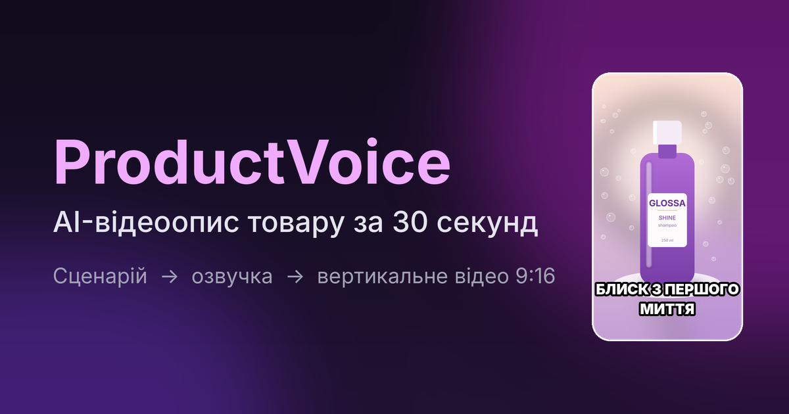

# ProductVoice — AI-відеоопис товару за 30 секунд

**Демо:** https://productvoice.vercel.app

Вводиш назву товару, опис і фото — сервіс пише рекламний сценарій, озвучує його і збирає вертикальне відео 9:16 із субтитрами, синхронними з голосом. Готовий ролик можна завантажити як MP4 для Reels, TikTok чи Shorts.



## Що вміє

- **Сценарій на 20–30 секунд** українською: hook → основне → заклик до дії. Кожен блок можна відредагувати або згенерувати інший варіант. На вибір — **Gemini** або **ChatGPT**.
- **Озвучка** через ElevenLabs із вибором голосу, плеєр і завантаження mp3.
- **Прев'ю 9:16**: фото товару з повільним наближенням (Ken Burns) і великі субтитри по 3–6 слів, точно під голос.
- **Експорт MP4 1080×1920** прямо в браузері — без сервера рендерингу.
- **Демо-приклад** одним натиском, прогрес-бари на кожному кроці, денний ліміт генерацій з одного IP.

## Як це працює

```
 Назва + опис ──► /api/script ──► Gemini / ChatGPT ──► { hook, body, cta }
                                                              │
                                          редагування в браузері
                                                              ▼
                       /api/voice ──► ElevenLabs TTS with timestamps
                                          │                  │
                                         mp3        таймінги кожного символу
                                          │                  │
                                          ▼                  ▼
 Фото (лишається в браузері) ──► Прев'ю 9:16 ◄── символи → слова → субтитри
                                          │
                                          ▼
                       canvas + Web Audio + MediaRecorder ──► MP4
```

- API-ключі живуть лише на сервері (route handlers) — у браузер і GitHub не потрапляють.
- Відповідь моделі обмежена **JSON-схемою** (structured output), тому завжди коректно парситься.
- Субтитри будуються з посимвольних таймінгів ElevenLabs: символи склеюються в слова, слова — у фрази по 3–6 слів з розривами на розділових знаках.
- Відео рендериться в реальному часі на canvas: кожен кадр малюється за поточним часом аудіо, тож субтитри й голос не розходяться.
- Фото не завантажується на сервер.

## Стек

Next.js (App Router) · TypeScript · Tailwind CSS · Vercel  
Gemini API (`@google/genai`) · OpenAI Responses API (REST) · ElevenLabs API (REST) · Upstash Redis (REST)

## Структура

```
app/
  page.tsx                 головна
  api/script/route.ts      сценарій (Gemini / ChatGPT)
  api/voice/route.ts       озвучка (ElevenLabs)
components/
  ProductForm.tsx          форма, демо-приклад, стан усього сценарію
  ScriptView.tsx           редагування сценарію
  VoicePanel.tsx           вибір голосу, плеєр, mp3
  Preview.tsx              плеєр 9:16 із субтитрами, експорт відео
  ProgressBar.tsx
lib/
  prompt.ts                промпт і JSON-схема сценарію
  gemini.ts · openai.ts    генерація сценарію
  elevenlabs.ts            озвучка з таймінгами
  subtitles.ts             таймінги → субтитри
  renderVideo.ts           рендер MP4 у браузері
  rateLimit.ts             денний ліміт з одного IP
```

## Локальний запуск

```bash
git clone https://github.com/malyura87-cmd/productvoice.git
cd productvoice
npm install
cp .env.example .env.local   # заповнити ключі
npm run dev
```

Відкрити http://localhost:3000

| Змінна | Обов'язкова | Що це |
|---|---|---|
| `GEMINI_API_KEY`, `GEMINI_MODEL` | так* | ключ і модель з Google AI Studio |
| `OPENAI_API_KEY`, `OPENAI_MODEL` | ні* | друга модель для перемикача |
| `ELEVENLABS_API_KEY` | так | ключ ElevenLabs (достатньо доступу Text to Speech) |
| `ELEVENLABS_VOICE_IDS` | так | `id1,id2` або `Жіночий:id1,Чоловічий:id2` |
| `DAILY_LIMIT` | ні | генерацій на день з одного IP, за замовчуванням 3 |
| `UPSTASH_REDIS_REST_URL`, `UPSTASH_REDIS_REST_TOKEN` | ні | лічильник ліміту; без них ліміт вимкнено |

\* потрібна хоча б одна модель для сценарію.

## Обмеження

- На безкоштовному плані ElevenLabs через API працюють лише голоси з розділу **Default** і власні (Voice Design), а не голоси з Voice Library.
- Відео записується в реальному часі (ролик 25 с ≈ 25 с запису); вкладку не можна згортати.
- MP4 з H.264 дають Safari та Chrome там, де є кодер; інакше браузер записує WebM.

## Як зроблено

Проєкт зібраний за один вечір разом із **Claude** (Anthropic) за покроковим ТЗ ([`TZ.md`](TZ.md)) — шість етапів, кожен перевірявся на живому деплої Vercel перед наступним.

Voice by [ElevenLabs](https://elevenlabs.io).
